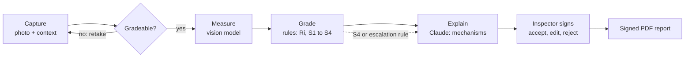

# Anode

**A pocket metallurgist for anyone who has to look at rust and decide what to do.**

Photograph corroded coated steel. Anode outlines the corrosion, grades it against
**ISO 4628-3** (Ri 0 to 5), assigns an action severity (**S1 Cosmetic** to **S4 Critical**),
ranks the likely corrosion mechanisms, recommends the next inspection step and drafts
a report. A qualified human inspector signs it.

> A sacrificial anode corrodes so the structure doesn't. Anode takes the hit to protect your asset.

> [!IMPORTANT]
> Anode is a **screening and documentation aid, not a certified inspection.**
> It never certifies an asset as safe, and every report needs an inspector's sign-off.

---

## Why it's different

Detecting rust in a photo is a solved, commodity problem. Deciding what that rust *means*
is not. Anode encodes a materials engineer's judgement and makes it checkable:

| Principle | What it means in practice |
|---|---|
| **Measured, then graded by rules** | A vision model measures percent area rusted. Plain, tested code turns that into a grade. Same numbers, same grade, every time. |
| **Escalates instead of guessing** | Low confidence never produces a "cosmetic" verdict. Pressure equipment, suspected cracking, corrosion under insulation, injury risk and any S4 always go to a human. |
| **Never invents what a photo can't show** | Pit depth and wall loss come only from entered thickness readings, never from pixels. |
| **Advice from a fixed library** | Recommendations are picked from a reviewed list, so the advice is consistent and auditable. |
| **The AI drafts, the inspector decides** | Every finding stays a draft until an inspector accepts, edits or rejects it. Edits are kept as feedback. |
| **Judged against an expert** | Evaluated on a gold set labelled by a metallurgical engineer with field pipeline inspection experience. Results are published, misses included. |

## How an inspection works

The AI is split into three parts so each one can be checked on its own:

1. **Measure:** a segmentation model outlines corroded areas and returns percent area rusted with a confidence.
2. **Grade:** deterministic code maps the measurement to ISO 4628-3 Ri 0 to 5 and to severity S1 to S4. No AI in this step.
3. **Explain:** Claude reads the photo, measurements and context answers, ranks up to three likely mechanisms with their evidence, and picks recommendations from the fixed library. It cannot change a grade.

## Severity scale

| Severity | Action |
|---|---|
| **S1 Cosmetic** | Monitor at the normal interval |
| **S2 Developing** | Plan maintenance; re-inspect sooner |
| **S3 Significant** | Schedule repair; measure thickness (UT) before the next interval |
| **S4 Critical** | Stop and escalate to a qualified inspector now |

S1 to S4 is Anode's own action scale, mapped from the standards rather than taken from any one of them.

## Scope

**Phase 1 (MVP), "Rust Grader", in development:** coated steel, one photo per inspection point,
scale-reference check, corrosion outline, ISO 4628-3 grade, S1 to S4, top-three mechanisms,
recommendation, PDF report and human sign-off.

| Phase | Name | Adds |
|---|---|---|
| 1 | Rust Grader | The MVP above |
| 2 | Point history and remaining life | Trends per inspection point, UT thickness entry, API 570 corrosion rate and remaining life, ASTM G46 pit density |
| 3 | Fracture reader | Fatigue, ductile and brittle fracture surfaces, with a teaching mode |
| 4 | Field kit | Offline capture and sync, team accounts, asset registers |

## Build progress (Phase 1)

Built one stage at a time, each approved before the next begins.

| # | Stage | Status |
|---|---|---|
| 1 | Domain model ([`docs/domain-model.md`](docs/domain-model.md)) | Approved |
| 2 | Database ([`docs/database.md`](docs/database.md)) | In review |
| 3 | API contracts (`docs/api.md`) | Not started |
| 4 | Design system | Not started |
| 5 | Grading engine | Not started |
| 6 | Measurement model | Not started |
| 7 | Inspection flow | Not started |
| 8 | Explain step | Not started |
| 9 | Sign-off and report | Not started |
| 10 | Ship | Not started |

## Stack

| Layer | Choice |
|---|---|
| Web app | Next.js + TypeScript on Vercel, phone-first |
| Data, auth, photos | Supabase: Postgres, Auth, Storage, row-level security |
| UI | Tailwind CSS + Motion |
| Explain step and report text | Claude API |
| Measurement model | Segmentation model trained in Google Colab, served as a small Python API |
| Reports | Server-generated PDF |
| Tests | Vitest (grading rules and logic), Playwright (main flows) |

## Documentation

- [`docs/PRD.md`](docs/PRD.md): product requirements, business rules, build stages
- [`docs/domain-model.md`](docs/domain-model.md): entities, constraints, indexes and permissions, traced to the business rules
- [`docs/decisions.md`](docs/decisions.md): decisions and instructions per stage
- [`docs/database.md`](docs/database.md): migrations, row-level security, seed data and how to run the database tests
- `docs/evaluation.md`: gold-set results (from Stage 6)

## Standards

Grades cite the standard and edition they come from. Anode cites standards; it never reproduces
their paid pictorial references.

- **ISO 4628-3:** rusting of coated steel (Phase 1)
- **ASTM D610 / SSPC-VIS 2:** rusting of painted steel (later)
- **ASTM G46:** pitting (Phase 2)
- **API 570 / 510 / 653:** corrosion rate and remaining life from thickness readings (Phase 2)

## Disclaimer

Anode is a screening and documentation aid, not a certified inspection. It grades what it can see,
says how sure it is, and escalates what it cannot judge. Every report requires sign-off by a
qualified inspector. Not legal advice; terms will be reviewed before any paid use.

---

Built by Michael Obarijima, metallurgical and materials engineer.
