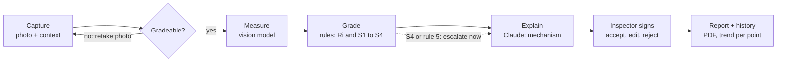

# Corrosion & Failure Inspection Copilot: Product Requirements

2026-11-18 · Michael

> Exported from the Claude Docs requirements document on 2026-11-18. That document is the source of truth; if the two disagree, the Claude Docs version wins and this file should be re-exported.

## Vision and positioning

The Copilot turns a phone photo of corroded or failed metal into a graded finding, a likely cause, a recommended next test and a finished inspection report, the way an experienced metallurgist would.

- **Working name:** Anode. A sacrificial anode corrodes so the structure does not; the product takes the hit to protect the asset.
- **One line:** a pocket metallurgist for anyone who has to look at rust or a broken part and decide what to do.
- **Why it matters:** corrosion was estimated to cost US$2.5 trillion a year, about 3.4% of global GDP, and known corrosion-control practice could save 15 to 35% of that ([NACE IMPACT study, 2016](https://inspectioneering.com/news/2016-03-08/5202/nace-study-estimates-global-cost-of-corrosion-at-25-trillion-ann); treat it as an order-of-magnitude estimate, per [Reliability magazine](https://reliamag.com/topics/guides/cost-of-corrosion-statistics)).
- **The edge:** detecting rust in a photo is common; many open datasets exist ([Roboflow Universe](https://universe.roboflow.com/failure-sjoo6/corrosion-instance-segmentation-sfcpc-1yuxj)). Grading against a standard, naming the mechanism, choosing the next NDT method and writing a defensible report needs a materials engineer's judgement. That judgement is what Michael encodes and others cannot fake.
- **Positioning:** "AI for the physical world: corrosion, failure and safety", built by a metallurgical engineer with field pipeline NDT experience.

## Users and the jobs they need done

The first user is the field inspector; everyone else either sends photos to one or reads their reports.

| User | Where they work | Job to be done | What they pay for |
|---|---|---|---|
| Field inspector / NDT technician | Pipelines, tanks, plants, offshore | Grade findings fast, write the report, keep history per spot | Hours saved on reports; consistency |
| Asset or maintenance engineer | Refineries, factories, utilities | Decide repair now, monitor, or ignore | Fewer surprise failures; prioritised work |
| Facility / estate manager | Buildings, water towers, bridges, ports | Know if the rust they see is cosmetic or serious | A clear verdict and when to call an expert |
| Fabricator / welder | Workshops, roadside fabrication | Avoid building in corrosion (wrong metal pairs, wrong coating) | Fewer callbacks and failed jobs |
| Engineering student / trainee inspector | Universities, training schools | Learn to read corrosion and fracture surfaces | Practice with feedback |

The portfolio version targets the first and last rows: inspectors prove the product works, students make it spread.

## Core workflows

One inspection runs capture, check, measure, grade, explain, sign and report; the AI drafts, the inspector decides.



*A human signs every finding the AI drafts.*

A blurry or unscaled photo goes straight back for a retake, and anything graded S4 or caught by the escalation rules is flagged before the report is drafted.

## Domain foundations

Every grade the Copilot gives is tied to a published standard, so its output reads like an inspector's, not a guess.

| Standard | What it rates | Scale the Copilot uses | Fits photo-based AI? |
|---|---|---|---|
| [ISO 4628-3](https://standards.iteh.ai/catalog/standards/iso/d7c3aa71-8e7e-49fa-bbbd-a607b78d8c2f/iso-4628-3-2016) | Rusting of coated steel, by comparison with pictorial references | Ri 0 (0% rusted) to Ri 5 (about 40 to 50%); Ri 3 is about 1% | Yes: it is visual by design |
| [ASTM D610 / SSPC-VIS 2](https://standards.iteh.ai/catalog/standards/astm/5b5241ce-041c-4972-b20b-d82c7b88bec9/astm-d610-082012) | Rusting of painted steel | Grade 10 to 0 by percent of visible rust; distribution as spot, general, pinpoint or hybrid | Yes |
| ISO 8501-1 | Rust grade of uncoated steel before painting (grades A to D, per the [ISO 4628-3 note](https://standards.iteh.ai/catalog/standards/iso/d7c3aa71-8e7e-49fa-bbbd-a607b78d8c2f/iso-4628-3-2016)) | A to D | Yes |
| [ASTM G46](https://cdn.standards.iteh.ai/samples/110856/058333ec47124ac296e8c34cf18a2470/ASTM-G46-21.pdf) | Pitting: size, shape, density of pits | Density and size from the photo; depth needs a gauge or cross-section | Partly: depth cannot come from a photo |
| [API 570](https://blog.projectmaterials.com/quick-answers/epc/what-is-api-570/) (and API 510 / 653 for vessels and tanks) | In-service piping: corrosion rate and remaining life from thickness readings | Calculation, not a photo grade | Yes, when the user enters UT readings |

The standards themselves are paid documents; buying the current editions of ISO 4628-3 and ASTM D610 is a project cost. The Copilot cites the standard and edition on every grade.

**Remaining life (API 570).** When the user enters wall-thickness readings over time, the Copilot calculates the corrosion rate and remaining life ([API 570 study guide](https://open-exam-prep.com/study-guides/api-570/inspection-intervals-extent-of-inspection/thickness-inspection-intervals)):

```latex
\text{Remaining life (years)} = \frac{t_{\text{actual}} - t_{\text{required}}}{\text{corrosion rate}}
```

The next thickness check is due at no more than half the remaining life, and no later than the class limit for that piping.

**Mechanisms the Copilot names (first release):** uniform corrosion, pitting, galvanic corrosion, crevice corrosion, corrosion under insulation (CUI), coating breakdown with underfilm rust, and microbiologically influenced corrosion as a flagged possibility only. Each is a visual pattern plus context questions (material, environment, coating, insulation).

## Business rules (draft for Michael to confirm)

The Copilot never certifies an asset as safe; it grades what it can see, says how sure it is, and escalates anything it cannot judge.

**Core objects**

- **Asset:** the thing inspected (pipe, tank, beam, hull plate, bolt), with material, coating, environment and location.
- **Inspection point:** a fixed spot on an asset, revisited over time. History lives here.
- **Inspection:** one visit to one point: photos, context answers, optional thickness readings, inspector.
- **Finding:** one defect on one inspection: type, mechanism, standard grade, severity, confidence, recommendation.
- **Report:** a signed set of findings for one or more inspections.

**Rules**

1. **A photo is only graded when it is gradeable.** It must show the surface in focus, lit evenly, with a scale reference (coin, ruler or marker) for size measurements. Otherwise the Copilot asks for a retake and grades nothing.
2. **Every finding carries one standard grade, one severity and one confidence.** The grade follows its standard (Ri, D610 grade, pit density). Severity is the Copilot's own four-level action scale below. Confidence is high, medium or low.
3. **Severity drives action, not the other way round:**
   - **S1 Cosmetic:** monitor at the normal interval.
   - **S2 Developing:** plan maintenance; re-inspect sooner.
   - **S3 Significant:** schedule repair; measure thickness (UT) before the next interval.
   - **S4 Critical:** stop and escalate to a qualified inspector now.
4. **Low confidence never produces S1.** If the Copilot is unsure, it rounds the severity up and says why.
5. **Mandatory escalation, whatever the grade:** pressure-containing equipment showing pitting or wall loss; suspected cracking; suspected CUI; any S4; and any asset where failure could injure people.
6. **Depth and wall loss are never inferred from a photo.** They come from entered measurements only. Without them, remaining life is shown as "needs thickness data".
7. **Mechanism is a ranked hypothesis, not a verdict.** The Copilot lists up to three likely mechanisms with the visual evidence and context answer behind each.
8. **Recommendations come from a fixed library** (for example "UT thickness grid at this point", "remove insulation and inspect", "check for dissimilar-metal contact"), so advice is consistent and reviewable.
9. **A human signs every report.** AI findings stay in "draft" until an inspector accepts, edits or rejects each one. Edits are kept as training feedback.
10. **Trend beats snapshot.** When a point has history, the Copilot compares the new grade with past ones and flags faster-than-expected change.

Decided (18 Nov 2026): the S1 to S4 scale is Anode's own, mapped from the standards, not taken from any one of them. The escalation list in rule 5 stays as written.

## AI approach and data

The AI is split into three parts so each can be checked: a vision model measures, fixed rules grade, and a language model explains.

1. **Measure (vision model).** A segmentation model outlines corroded areas and pits on the photo. With the scale reference, it returns percent area rusted, pit count and pit size. Trained on Google Colab, served as an API; nothing heavy runs on the laptop.
2. **Grade (deterministic rules).** Plain code maps the measurements to the standard grade (for example percent area to Ri 0 to 5) and to S1 to S4 using the business rules. No AI here: the same numbers always give the same grade.
3. **Explain (language model with vision).** A multimodal model (Claude) reads the photo, the measurements and the context answers, then ranks likely mechanisms and picks recommendations from the fixed library. It drafts the report text. It cannot change a grade.

**Data**

- **Open datasets:** several corrosion detection and segmentation sets on [Roboflow Universe](https://universe.roboflow.com/failure-sjoo6/corrosion-instance-segmentation-sfcpc-1yuxj), many under CC BY 4.0. Check each licence before use.
- **Michael's own photos:** rusted structures around Port Harcourt (gates, tanks, roofing, bridges, boats), taken with a scale reference. Field photos from past client work are only used with written permission.
- **Gold set:** about 200 photos labelled by Michael with grade, mechanism and severity. This is the expert asset and the evaluation set; it is never used for training.

**How it is judged**

| Check | Measure | Target for the portfolio release |
|---|---|---|
| Area measurement | Percent-area error against Michael's labels | Set after the first gold-set run |
| Grade agreement | Copilot grade equals Michael's grade, or within one step | Set after the first gold-set run |
| Escalation recall | Share of Michael's S3 and S4 cases the Copilot also escalates | As close to 100% as possible; this is the safety number |
| Mechanism | Michael's mechanism appears in the Copilot's top three | Set after the first gold-set run |

Targets are left open on purpose: they come from the first honest measurement, not from a guess.

**Architecture, confirmed 18 Nov 2026:** segmentation model trained in Colab and hosted as a small API; Claude for the explain step; grading in plain code; Supabase for data and photos; a web app first, phone-friendly, before any native app.

## MVP scope versus later phases

The first release does one thing very well: coated or bare steel, photo in, graded finding and report out.

1. **Phase 1, MVP: "Rust Grader".**
   - In: one photo per point, scale reference check, corrosion outline, Ri / D610 grade, S1 to S4, top-three mechanisms, recommendation, PDF report, human sign-off.
   - Out: pitting depth, remaining life, history, teams.
   - Gate to Phase 2: gold-set results published, and five real inspectors or engineers have tried it.
2. **Phase 2: "Point history and remaining life".**
   - Inspection points revisited over time with trend flags; UT thickness entry with API 570 corrosion rate, remaining life and next-inspection date; pit density per ASTM G46.
3. **Phase 3: "Fracture reader".**
   - Photo of a broken part: fatigue (beach marks), ductile or brittle overload, with a teaching mode for students.
4. **Phase 4: "Field kit".**
   - Offline capture on a phone for sites with no network, sync later; team accounts; asset registers.

Anything not in Phase 1 waits, however tempting.

## Stack (approved 18 Nov 2026)

| Layer | Choice |
|---|---|
| Web app | Next.js + TypeScript on Vercel, phone-first |
| Data, auth, photos | Supabase: Postgres, Auth, Storage, row-level security |
| UI and motion | Tailwind CSS + Motion; IBM Plex Sans and Plex Mono (to confirm in the design system) |
| Explain step and report text | Claude API |
| Measurement model | Segmentation model trained in Google Colab, served as a small Python API; host decided in Stage 6 |
| Reports | Server-generated PDF |
| Tests | Vitest for grading rules and logic; Playwright for the main flows |

## Build stages and definition of done (Phase 1)

Claude Code works one stage at a time and stops for Michael's approval at the end of each.

1. **Domain model.** Done when: `docs/domain-model.md` lists every entity, relationship, constraint, index and permission, traced to a business rule; every assumption is listed; Michael approves.
2. **Database.** Done when: Supabase migrations create the approved model; row-level security means an inspector sees only their own organisation's data; seed data loads; migration tests pass.
3. **API contracts.** Done when: `docs/api.md` defines every endpoint or server action with inputs, outputs, errors and validation (Zod); Michael approves.
4. **Design system.** Done when: colours, type, spacing, components and motion rules are in code as tokens and a component page renders them; contrast passes WCAG AA; severity colours S1 to S4 are distinct for colour-blind users.
5. **Grading engine.** Done when: plain functions map percent-rusted to ISO 4628-3 Ri 0 to 5 and to S1 to S4 per the business rules; rule 4 (low confidence never gives S1) and rule 5 (mandatory escalation) are enforced; unit tests cover every boundary value; 100% branch coverage on this module.
6. **Measurement model.** Done when: a Colab notebook trains the segmentation model on licensed data; it is served behind an API that returns outline, percent area and confidence; gold-set results are written to `docs/evaluation.md`.
7. **Inspection flow.** Done when: on a phone, a user can create an asset and point, take a photo, pass the gradeable-photo check (or be asked to retake), see the outline draw in, get grade, severity and mechanisms, and save as draft.
8. **Explain step.** Done when: Claude ranks up to three mechanisms with evidence and picks recommendations only from the fixed library; it cannot change a grade (enforced in code, with a test).
9. **Sign-off and report.** Done when: an inspector accepts, edits or rejects each finding; edits are stored as feedback; a signed PDF report downloads; reports show "screening only".
10. **Ship.** Done when: deployed on Vercel with a public demo account; README shows a demo GIF, architecture and the honest evaluation numbers; error monitoring and basic rate limiting on the AI and model endpoints are on.

Every stage ends with: tests passing, no lint errors, a short report of what changed and which assumptions were made.

## Risks, limits and liability

The biggest risk is someone trusting a photo grade over a proper inspection; the product is designed so that cannot happen quietly.

| Risk | What could go wrong | How the product handles it |
|---|---|---|
| False reassurance | A serious defect graded as cosmetic | Low confidence rounds up; mandatory escalation list; "screening only" shown on every report |
| Hidden damage | Wall loss, internal or under-insulation corrosion not visible | Never inferred from photos; Copilot asks for UT or insulation removal |
| Rust staining and discolouration | Staining or chemical marks mistaken for corrosion (a caution [ASTM D610](https://www.scribd.com/doc/316293504/ASTM-D-610) itself gives) | Context questions; flagged as possible staining |
| Bad photos | Glare, blur, no scale | Gradeable-photo check before any grade |
| Standards licensing | Reproducing paid pictorial standards | Cite standards; never copy their reference images |
| Data permissions | Using client or employer field photos | Only with written permission; own photos and licensed datasets otherwise |
| Overreach | Being read as a certified inspection | Human sign-off on every report; terms state it is a decision aid |

Not legal advice: before any paid use, the disclaimer and terms should be reviewed by a lawyer.

## The wider product family

The Copilot is the first of a family of materials products that share one engine: photo plus context in, engineering judgement out.

| Product | What it does | Who uses it | Size to build |
|---|---|---|---|
| Galvanic Pair Checker | Pick two metals and an environment; see the corrosion risk and the fix (isolate, coat, change metal) | Fabricators, plumbers, students | Small: a weekend; a great first public demo |
| Weld Visual Check | Photo of a weld; flags visible defects such as porosity, undercut and spatter against the chosen code's visual criteria | Welders, QA inspectors, trainees | Medium |
| Scrap Sorter | Guided magnet, colour and spark tests plus photos to identify a metal grade | Scrap dealers, recyclers, foundries | Medium; large trade in Nigeria |
| Rebar Screen | Photo of rebar markings, ribs and rust plus a guided bend check, to flag doubtful steel before it goes into a building | Builders, site engineers, home builders | Medium; screening only |
| Coating Picker | Location and service conditions give a corrosivity category and a suggested coating system | Facility managers, painters, specifiers | Small to medium |
| Corrosivity Map (data project) | Map how aggressive the air is across Nigeria from humidity, rainfall and distance to the sea | Engineers, insurers, builders; great content | Data project; runs on public climate data |

Standards for the Weld and Coating products (for example the welding code in use, and the corrosivity categories) are to be confirmed before building them.

## Portfolio and build-in-public plan

Each week produces one shippable piece and two posts, so the work is visible while it is built.

- [ ] Week 1: take 50 rust photos around Port Harcourt with a coin for scale; post "what this rust is telling you" on X and LinkedIn
- [ ] Week 1: ship the Galvanic Pair Checker as the first public demo
- [ ] Week 2: label the first 100 gold-set photos (grade, mechanism, severity)
- [ ] Week 3: train the first segmentation model in Colab; post the before-and-after outlines
- [ ] Week 4: grading rules and report PDF working end to end
- [ ] Week 5: run the gold-set evaluation; publish the honest numbers, misses included
- [ ] Week 6: five inspectors or engineers try it; post what they said

**What goes on GitHub (Muddyscode):** the app, the grading rules with tests, the evaluation notebook and a README that explains the engineering decisions.

**Story for recruiters:** "Metallurgical engineer who built an AI inspection tool, measured it against expert labels, and designed it to escalate rather than guess."

## Open decisions for Michael

Decided on 18 Nov 2026:

| Decision | Choice |
|---|---|
| Product name | Anode (domain and trademark not yet checked) |
| Severity scale | S1 to S4 as written |
| Escalation list | Rule 5 kept as written |
| First surface and standard | Coated steel only, graded on ISO 4628-3 (Ri 0 to 5); buy ISO 4628-3 first |
| Architecture | Colab-trained segmentation API, Claude for explanations, grading in plain code, Supabase, phone-friendly web app first |

Still open:

- [ ] Check domain and trademark availability for Anode
- [ ] Whether any past field photos can be used, and who to ask for permission

## Sources

- [NACE IMPACT study coverage, Inspectioneering](https://inspectioneering.com/news/2016-03-08/5202/nace-study-estimates-global-cost-of-corrosion-at-25-trillion-ann)
- [Cost of corrosion figures and caveats, Reliability magazine](https://reliamag.com/topics/guides/cost-of-corrosion-statistics)
- [ISO 4628-3:2016 summary](https://standards.iteh.ai/catalog/standards/iso/d7c3aa71-8e7e-49fa-bbbd-a607b78d8c2f/iso-4628-3-2016)
- [ASTM D610 practice summary](https://standards.iteh.ai/catalog/standards/astm/5b5241ce-041c-4972-b20b-d82c7b88bec9/astm-d610-082012)
- [ASTM G46-21 preview](https://cdn.standards.iteh.ai/samples/110856/058333ec47124ac296e8c34cf18a2470/ASTM-G46-21.pdf)
- [API 570 overview](https://blog.projectmaterials.com/quick-answers/epc/what-is-api-570/)
- [API 570 remaining life and inspection intervals](https://open-exam-prep.com/study-guides/api-570/inspection-intervals-extent-of-inspection/thickness-inspection-intervals)
- [Corrosion segmentation dataset, Roboflow Universe](https://universe.roboflow.com/failure-sjoo6/corrosion-instance-segmentation-sfcpc-1yuxj)
