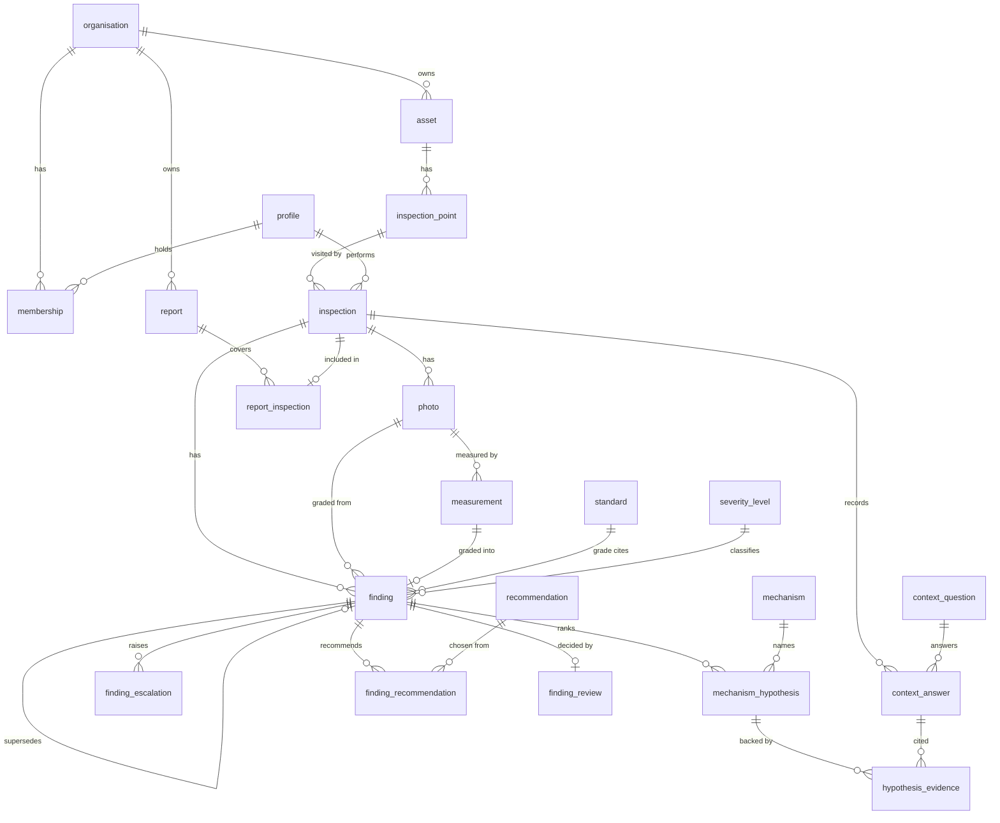
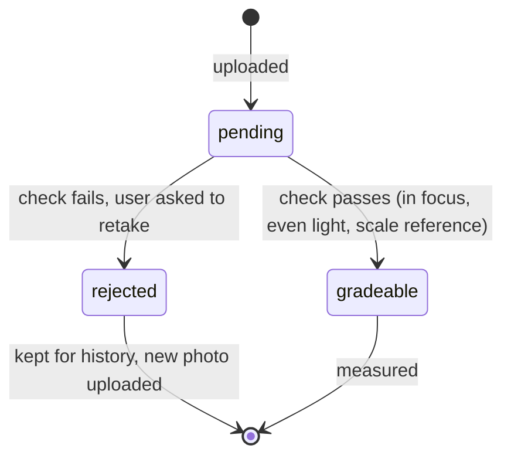
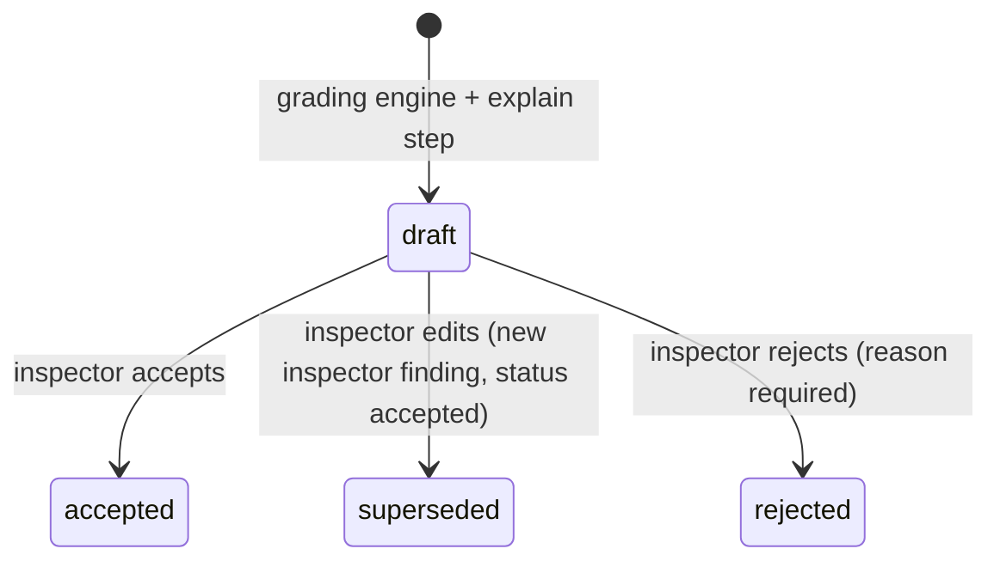
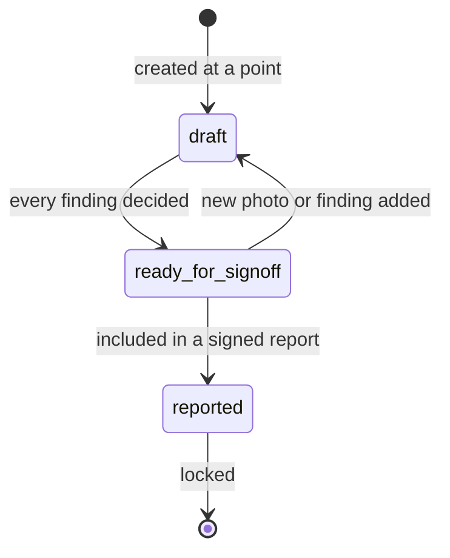

# Anode domain model (Phase 1)

Status: **Stage 1 draft, awaiting Michael's approval.** Nothing in this document is migrated yet.
Stage 2 turns it into Supabase migrations exactly as approved.

Source of requirements: [`PRD.md`](PRD.md). Business rules are cited as **R1** to **R10**
(PRD, "Business rules", rules 1 to 10). Other PRD requirements are cited as **P-** tags,
defined in [section 10](#10-traceability). Assumptions are **A1** onwards, listed in
[section 12](#12-assumptions). Open questions that need Michael's call are **Q1** onwards,
listed in [section 13](#13-questions-for-michael).

## Contents

1. [Scope](#1-scope)
2. [Conventions](#2-conventions)
3. [Entity map](#3-entity-map)
4. [Entities](#4-entities)
5. [Enumerations](#5-enumerations)
6. [Constraints](#6-constraints)
7. [Lifecycles](#7-lifecycles)
8. [Indexes](#8-indexes)
9. [Permissions](#9-permissions)
10. [Traceability](#10-traceability)
11. [Deferred to later phases](#11-deferred-to-later-phases)
12. [Assumptions](#12-assumptions)
13. [Questions for Michael](#13-questions-for-michael)

---

## 1. Scope

Phase 1, "Rust Grader": coated steel, one gradeable photo per inspection, graded on
ISO 4628-3 (Ri 0 to 5), severity S1 to S4, up to three ranked mechanisms, recommendations
from a fixed library, human sign-off and a signed PDF report.

The model covers what the app stores. It does **not** cover the gold set or training data,
which live with the measurement model (A27).

The PRD's five core objects map to entities as follows:

| PRD object | Entity | Notes |
|---|---|---|
| Asset | `asset` | |
| Inspection point | `inspection_point` | Created in Phase 1; history views wait for Phase 2 |
| Inspection | `inspection` + `photo` + `context_answer` | "Photos, context answers, optional thickness readings, inspector". Thickness readings are Phase 2 |
| Finding | `finding` + `finding_escalation` + `mechanism_hypothesis` + `finding_recommendation` + `finding_review` | Split so each rule can be enforced on its own |
| Report | `report` + `report_inspection` | |

Supporting entities: tenancy (`organisation`, `profile`, `membership`), reference data
(`standard`, `severity_level`, `mechanism`, `recommendation`, `context_question`) and
`measurement` (the vision model's output, kept separate from the grade it produced).

## 2. Conventions

These apply to every table unless the table says otherwise.

| Convention | Rule |
|---|---|
| Primary key | `id uuid`, default `gen_random_uuid()`. Clients may supply the id so retried uploads are idempotent (A4). |
| Tenancy | Every tenant-owned table has `org_id uuid not null`. Child tables reference their parent by the composite key `(org_id, parent_id)` so a row can never point at another organisation's data (C1). |
| Timestamps | `created_at timestamptz not null default now()`. Mutable tables also have `updated_at`, maintained by trigger. All times are stored in UTC. |
| Authorship | `created_by uuid` references `profile(id)` where a person creates the row. Rows written by the AI pipeline have `created_by null` and an explicit `origin` (C20). |
| Deletion | Assets and inspection points are archived (`archived_at`), never hard-deleted once they have an inspection. Nothing referenced by a signed report can be deleted or changed (C30). |
| Names | Tables are singular `snake_case`. Enumerations are Postgres enum types (section 5); reference data that carries text or versions is a table (section 4.2). |
| Reference data | Global (no `org_id`), seeded by migration, read-only to every user. |

## 3. Entity map

## 4. Entities

Column types are Postgres types. "Rule" ties a column to the requirement it exists for.

### 4.1 Tenancy and people

#### E1 `organisation`

The tenant boundary. Every inspector sees only their own organisation's data (Stage 2 definition of done).

| Column | Type | Null | Notes | Rule |
|---|---|---|---|---|
| `id` | uuid | no | | |
| `name` | text | no | 1 to 120 characters | |
| `is_demo` | boolean | no | default `false`. Marks the public demo organisation (Stage 10) | A25 |
| `created_at` | timestamptz | no | | |

#### E2 `profile`

One row per Supabase Auth user; `id` equals `auth.users.id`.

| Column | Type | Null | Notes | Rule |
|---|---|---|---|---|
| `id` | uuid | no | PK, FK to `auth.users(id)` on delete restrict | |
| `display_name` | text | no | Printed on reports | R9 |
| `qualification` | text | yes | Free text, for example "API 570 authorised inspector". Printed beside the signature | R9, A21 |
| `created_at`, `updated_at` | timestamptz | no | | |

#### E3 `membership`

Links a person to an organisation with a role.

| Column | Type | Null | Notes | Rule |
|---|---|---|---|---|
| `org_id` | uuid | no | FK `organisation` | |
| `user_id` | uuid | no | FK `profile` | |
| `role` | `member_role` | no | `admin`, `inspector`, `viewer` | §9 |
| `created_at` | timestamptz | no | | |

Primary key `(org_id, user_id)`. On sign-up a trigger creates a personal organisation and an
`admin` membership (A2).

### 4.2 Reference data (global, read-only)

#### E4 `standard`

Every grade cites the standard and edition it comes from (P-CITE).

| Column | Type | Null | Notes |
|---|---|---|---|
| `id` | uuid | no | |
| `code` | text | no | for example `ISO 4628-3` |
| `edition` | text | no | for example `2016` |
| `title` | text | no | |
| `grade_scale` | `grade_scale` | no | Phase 1 seeds one row: `iso_4628_3_ri` |
| `grade_min`, `grade_max` | smallint | no | `0` and `5` for Ri |
| `is_active` | boolean | no | Only active standards can be used for new findings |

Unique `(code, edition)`.

#### E5 `severity_level`

The S1 to S4 action scale and its fixed action text (R3). Seeded, never edited by users.

| Column | Type | Null | Notes |
|---|---|---|---|
| `code` | `severity` | no | PK: `S1` to `S4` |
| `name` | text | no | Cosmetic, Developing, Significant, Critical |
| `action` | text | no | R3 wording, for example "Stop and escalate to a qualified inspector now" |
| `requires_escalation` | boolean | no | `true` only for `S4` (R5) |

#### E6 `mechanism`

The mechanisms the Copilot may name in the first release (P-MECH).

| Column | Type | Null | Notes |
|---|---|---|---|
| `code` | text | no | PK: `uniform`, `pitting`, `galvanic`, `crevice`, `cui`, `coating_breakdown_underfilm`, `mic` |
| `name` | text | no | |
| `possibility_only` | boolean | no | `true` for `mic`: always worded as "possible", never as the leading conclusion (C17) |
| `escalation_reason` | `escalation_reason` | yes | `suspected_cui` for `cui`; null otherwise (R5) |
| `is_active` | boolean | no | |

#### E7 `recommendation`

The fixed recommendation library (R8). The explain step can only reference rows here.

| Column | Type | Null | Notes |
|---|---|---|---|
| `code` | text | no | PK, for example `ut_thickness_grid`, `remove_insulation_inspect`, `check_dissimilar_metal_contact` |
| `text` | text | no | The sentence printed on the report |
| `version` | integer | no | Bumped when the wording changes; old versions kept (A15) |
| `min_severity` | `severity` | yes | Optional floor; for example a UT grid is not offered for S1 |
| `is_active` | boolean | no | |

The Phase 1 library content is for Michael to write (Q6). Seeded in Stage 2.

#### E8 `context_question`

Fixed questions asked at capture time; answers feed mechanism ranking (R7).

| Column | Type | Null | Notes |
|---|---|---|---|
| `key` | text | no | PK, for example `standing_water`, `dissimilar_metal_contact`, `possible_staining_source` |
| `prompt` | text | no | Text shown to the user |
| `answer_type` | `answer_type` | no | `boolean`, `single_choice`, `number`, `text` |
| `options` | jsonb | yes | Required for `single_choice`, null otherwise (C8) |
| `sort_order` | integer | no | |
| `is_active` | boolean | no | |

Asset-level facts (material, coating, environment, insulation) live on `asset`, not here (A9).

### 4.3 Asset register

#### E9 `asset`

The thing inspected (PRD core object "Asset").

| Column | Type | Null | Notes | Rule |
|---|---|---|---|---|
| `id`, `org_id` | uuid | no | | |
| `name` | text | no | 1 to 120 characters | |
| `asset_type` | `asset_type` | no | pipe, tank, beam, hull_plate, bolt, structure, other | P-OBJ |
| `material` | `material` | no | carbon_steel, low_alloy_steel, stainless_steel, galvanised_steel, cast_iron, other, unknown | P-OBJ |
| `coating_status` | `coating_status` | no | coated, uncoated, unknown | P-SCOPE |
| `coating_description` | text | yes | for example "epoxy primer + PU topcoat" | P-OBJ |
| `environment` | `environment` | no | atmospheric_rural, atmospheric_urban, atmospheric_industrial, atmospheric_marine, immersed, buried, indoor, other | P-OBJ |
| `is_insulated` | boolean | no | Drives the CUI escalation (R5) | R5 |
| `is_pressure_containing` | boolean | no | Drives the pressure-equipment escalation (R5) | R5 |
| `failure_could_injure` | boolean | no | Drives the injury-risk escalation (R5) | R5 |
| `location_text` | text | yes | Free text, for example "Trans-Amadi yard, tank 3" | P-OBJ |
| `latitude`, `longitude` | numeric(9,6) | yes | Both or neither (C6) | P-OBJ |
| `archived_at` | timestamptz | yes | Archived assets are hidden, not deleted | |
| `created_by`, `created_at`, `updated_at` | | | | |

The three R5 booleans have no default: the user must answer them when creating the asset (A10).

#### E10 `inspection_point`

A fixed spot on an asset, revisited over time. History lives here (P-OBJ).

| Column | Type | Null | Notes |
|---|---|---|---|
| `id`, `org_id` | uuid | no | |
| `asset_id` | uuid | no | FK `(org_id, asset_id)` → `asset` |
| `label` | text | no | for example "North shell, 2 m above ground". Unique per asset, case-insensitive (C5) |
| `description` | text | yes | |
| `archived_at` | timestamptz | yes | |
| `created_by`, `created_at`, `updated_at` | | | |

### 4.4 Inspection

#### E11 `inspection`

One visit to one point (P-OBJ).

| Column | Type | Null | Notes | Rule |
|---|---|---|---|---|
| `id`, `org_id` | uuid | no | | |
| `point_id` | uuid | no | FK `(org_id, point_id)` → `inspection_point` | |
| `inspector_id` | uuid | no | FK `profile`; must be a member of `org_id` (C3) | P-OBJ |
| `inspected_at` | timestamptz | no | When the visit happened; not in the future (C7) | R10 |
| `status` | `inspection_status` | no | `draft`, `ready_for_signoff`, `reported` (section 7) | R9 |
| `notes` | text | yes | | |
| `created_at`, `updated_at` | | | | |

#### E12 `context_answer`

The answers given for one inspection (P-OBJ: "context answers").

| Column | Type | Null | Notes |
|---|---|---|---|
| `id`, `org_id` | uuid | no | |
| `inspection_id` | uuid | no | FK `(org_id, inspection_id)` |
| `question_key` | text | no | FK `context_question(key)` |
| `value` | jsonb | no | Shape matches the question's `answer_type` (C8) |
| `created_at`, `updated_at` | | | |

Unique `(inspection_id, question_key)`.

#### E13 `photo`

An uploaded image and the result of the gradeable-photo check (R1). Rejected photos are kept so
the retake history is visible (A6).

| Column | Type | Null | Notes | Rule |
|---|---|---|---|---|
| `id`, `org_id` | uuid | no | | |
| `inspection_id` | uuid | no | FK `(org_id, inspection_id)` | |
| `storage_path` | text | no | `{org_id}/{inspection_id}/{photo_id}.{ext}` in the `inspection-photos` bucket; unique | |
| `content_sha256` | text | no | 64 hex characters; detects re-uploads | A4 |
| `mime_type` | text | no | `image/jpeg`, `image/png`, `image/heic`, `image/webp` | |
| `width_px`, `height_px` | integer | no | > 0 | |
| `captured_at` | timestamptz | yes | From the device, if known | |
| `gradeability` | `gradeability` | no | `pending`, `gradeable`, `rejected`; default `pending` | R1 |
| `rejection_reasons` | `photo_rejection_reason[]` | no | default `{}`. `out_of_focus`, `uneven_lighting`, `glare`, `no_scale_reference`, `surface_not_visible` | R1 |
| `scale_reference` | `scale_reference` | no | `coin`, `ruler`, `marker`, `none`; default `none` | R1 |
| `mm_per_px` | numeric(10,6) | yes | Derived from the scale reference; > 0 | R1 |
| `checked_at` | timestamptz | yes | When the gradeability check ran | R1 |
| `uploaded_by`, `created_at` | | | | |

Gradeability rules are C9 and C10. EXIF location data is stripped on upload (A7).

#### E14 `measurement`

The vision model's output for one photo. Kept separate from the grade so "same numbers, same
grade" can be checked (P-AI). Immutable once written (C19).

| Column | Type | Null | Notes | Rule |
|---|---|---|---|---|
| `id`, `org_id` | uuid | no | | |
| `photo_id` | uuid | no | FK `(org_id, photo_id)`; photo must be `gradeable` (C11) | R1 |
| `model_name` | text | no | | P-AI |
| `model_version` | text | no | | P-AI |
| `percent_area_rusted` | numeric(6,3) | no | 0 to 100 inclusive | P-AI |
| `outline` | jsonb | no | GeoJSON `MultiPolygon` in image-pixel coordinates (A12) | P-AI |
| `model_confidence` | numeric(4,3) | no | 0 to 1 inclusive | R2 |
| `created_at` | timestamptz | no | | |

Unique `(photo_id, model_name, model_version)`. There are deliberately **no** depth, wall-loss or
thickness columns (R6).

### 4.5 Findings

#### E15 `finding`

One defect on one inspection (P-OBJ). An AI finding is never edited: when an inspector edits it,
a new `inspector` finding supersedes it and the original is kept as feedback (R9, A17).

| Column | Type | Null | Notes | Rule |
|---|---|---|---|---|
| `id`, `org_id` | uuid | no | | |
| `inspection_id` | uuid | no | FK `(org_id, inspection_id)` | |
| `photo_id` | uuid | no | FK `(org_id, photo_id)`; same inspection; photo `gradeable` (C11) | R1 |
| `measurement_id` | uuid | yes | FK `(org_id, measurement_id)`; required when `origin = 'ai'` (C12) | P-AI |
| `origin` | `finding_origin` | no | `ai` or `inspector` | R9 |
| `supersedes_finding_id` | uuid | yes | FK `(org_id, id)` on `finding`; set only on `inspector` findings (C21) | R9 |
| `defect_type` | `defect_type` | no | `rusting`, `pitting`, `suspected_cracking`, `coating_breakdown`, `other` | P-OBJ |
| `standard_id` | uuid | no | FK `standard`; must be active when created (C13) | R2, P-CITE |
| `grade_value` | smallint | no | Within the standard's `grade_min`..`grade_max` (C13) | R2 |
| `rules_severity` | `severity` | no | Severity the grading rules gave before the confidence adjustment | R4 |
| `severity` | `severity` | no | Final severity; never lower than `rules_severity` for AI findings (C15) | R2, R3, R4 |
| `confidence` | `confidence` | no | `high`, `medium`, `low` | R2 |
| `severity_raised_reason` | text | yes | Required when `severity > rules_severity` (C15) | R4 |
| `possible_staining` | boolean | no | default `false`. "Flagged as possible staining" (PRD risks) | P-RISK |
| `summary` | text | yes | Report text drafted by the explain step or written by the inspector | P-AI |
| `status` | `finding_status` | no | `draft`, `accepted`, `rejected`, `superseded` (section 7) | R9 |
| `grading_rules_version` | text | yes | Required when `origin = 'ai'` (C12) | P-AI |
| `explain_model` | text | yes | Claude model id used by the explain step, if it ran | P-AI |
| `created_by` | uuid | yes | Required when `origin = 'inspector'`; null for `ai` (C20) | R9 |
| `created_at` | timestamptz | no | | |

Phase 1 creates one AI finding per inspection (one gradeable photo, one whole-photo Ri grade).
The schema allows more (A13).

Remaining life is not a column. With no thickness data the report shows "needs thickness data" (R6, A26).

#### E16 `finding_escalation`

Each reason a finding must go to a qualified inspector (R5). Rows are added, never removed (C16).

| Column | Type | Null | Notes | Rule |
|---|---|---|---|---|
| `id`, `org_id` | uuid | no | | |
| `finding_id` | uuid | no | FK `(org_id, finding_id)` | |
| `reason` | `escalation_reason` | no | `severity_s4`, `pressure_pitting_or_wall_loss`, `suspected_cracking`, `suspected_cui`, `injury_risk` | R5 |
| `source` | `escalation_source` | no | `grading_rules`, `explain_step`, `inspector` | R5 |
| `detail` | text | yes | Why it was raised | R5 |
| `acknowledged_by` | uuid | yes | FK `profile`; inspector or admin of the org | R5, R9 |
| `acknowledged_at` | timestamptz | yes | Both or neither with `acknowledged_by` | R5 |
| `acknowledgement_note` | text | yes | Required when acknowledged (C16) | R5 |
| `created_at` | timestamptz | no | | |

Unique `(finding_id, reason)`.

#### E17 `mechanism_hypothesis`

A ranked hypothesis, not a verdict (R7). Up to three per finding.

| Column | Type | Null | Notes | Rule |
|---|---|---|---|---|
| `id`, `org_id` | uuid | no | | |
| `finding_id` | uuid | no | FK `(org_id, finding_id)` | |
| `rank` | smallint | no | 1, 2 or 3 | R7 |
| `mechanism_code` | text | no | FK `mechanism(code)`; active | R7, P-MECH |
| `visual_evidence` | text | no | What in the photo supports it; not blank | R7 |
| `created_at` | timestamptz | no | | |

Unique `(finding_id, rank)` and `(finding_id, mechanism_code)`.

#### E18 `hypothesis_evidence`

Links a hypothesis to the context answers behind it (R7: "the visual evidence and context answer behind each").

| Column | Type | Null | Notes |
|---|---|---|---|
| `hypothesis_id` | uuid | no | FK `mechanism_hypothesis` |
| `context_answer_id` | uuid | no | FK `context_answer`; same inspection as the finding (C18) |
| `org_id` | uuid | no | |

Primary key `(hypothesis_id, context_answer_id)`.

#### E19 `finding_recommendation`

Recommendations chosen for a finding, only from the library (R8).

| Column | Type | Null | Notes |
|---|---|---|---|
| `finding_id` | uuid | no | FK `(org_id, finding_id)` |
| `recommendation_code` | text | no | FK `recommendation(code)`; active when chosen |
| `recommendation_version` | integer | no | The library version shown, so old reports stay reproducible (A15) |
| `sort_order` | smallint | no | 1 onwards |
| `org_id` | uuid | no | |

Primary key `(finding_id, recommendation_code)`.

#### E20 `finding_review`

The inspector's decision on one AI finding: the feedback record (R9). Immutable once written.

| Column | Type | Null | Notes | Rule |
|---|---|---|---|---|
| `id`, `org_id` | uuid | no | | |
| `finding_id` | uuid | no | FK `(org_id, finding_id)`; an `ai` finding; unique (one decision each) | R9 |
| `decision` | `review_decision` | no | `accept`, `edit`, `reject` | R9 |
| `revised_finding_id` | uuid | yes | Required when `decision = 'edit'`, null otherwise (C22) | R9 |
| `reason` | text | yes | Required for `edit` and `reject` (A18) | R9 |
| `reviewed_by` | uuid | no | FK `profile`; role `inspector` or `admin` (C23) | R9 |
| `reviewed_at` | timestamptz | no | | |

### 4.6 Reports

#### E21 `report`

A signed set of findings for one or more inspections (P-OBJ).

| Column | Type | Null | Notes | Rule |
|---|---|---|---|---|
| `id`, `org_id` | uuid | no | | |
| `title` | text | no | | |
| `status` | `report_status` | no | `draft`, `signed` | R9 |
| `created_by`, `created_at`, `updated_at` | | | | |
| `signed_by` | uuid | yes | FK `profile`; role `inspector` or `admin` | R9 |
| `signed_at` | timestamptz | yes | | R9 |
| `signer_name` | text | yes | Snapshot of `profile.display_name` at signing | R9 |
| `signer_qualification` | text | yes | Snapshot of `profile.qualification` at signing | R9 |
| `disclaimer_version` | text | yes | Version of the "screening only" wording printed (P-SCREEN) | P-SCREEN |
| `pdf_path` | text | yes | `{org_id}/{report_id}.pdf` in the `reports` bucket | P-PDF |
| `pdf_sha256` | text | yes | Hash of the signed PDF, so tampering is detectable | P-PDF |

When `status = 'signed'`, every signing column above is required (C26).

#### E22 `report_inspection`

Which inspections a report covers.

| Column | Type | Null | Notes |
|---|---|---|---|
| `report_id` | uuid | no | FK `(org_id, report_id)` |
| `inspection_id` | uuid | no | FK `(org_id, inspection_id)`; **unique**: an inspection appears in one report only (A20) |
| `org_id` | uuid | no | |

Primary key `(report_id, inspection_id)`. A report covers at least one inspection when signed (C27).

## 5. Enumerations

| Type | Values | Rule |
|---|---|---|
| `member_role` | `admin`, `inspector`, `viewer` | §9 |
| `grade_scale` | `iso_4628_3_ri` (Phase 1 only) | P-SCOPE |
| `severity` | `S1`, `S2`, `S3`, `S4` (ordered, so `S1 < S4`) | R3 |
| `confidence` | `low`, `medium`, `high` (ordered) | R2 |
| `answer_type` | `boolean`, `single_choice`, `number`, `text` | R7 |
| `asset_type` | `pipe`, `tank`, `beam`, `hull_plate`, `bolt`, `structure`, `other` | P-OBJ |
| `material` | `carbon_steel`, `low_alloy_steel`, `stainless_steel`, `galvanised_steel`, `cast_iron`, `other`, `unknown` | P-OBJ |
| `coating_status` | `coated`, `uncoated`, `unknown` | P-SCOPE |
| `environment` | `atmospheric_rural`, `atmospheric_urban`, `atmospheric_industrial`, `atmospheric_marine`, `immersed`, `buried`, `indoor`, `other` | P-OBJ |
| `inspection_status` | `draft`, `ready_for_signoff`, `reported` | R9 |
| `gradeability` | `pending`, `gradeable`, `rejected` | R1 |
| `photo_rejection_reason` | `out_of_focus`, `uneven_lighting`, `glare`, `no_scale_reference`, `surface_not_visible` | R1, P-RISK |
| `scale_reference` | `coin`, `ruler`, `marker`, `none` | R1 |
| `finding_origin` | `ai`, `inspector` | R9 |
| `defect_type` | `rusting`, `pitting`, `suspected_cracking`, `coating_breakdown`, `other` | P-OBJ |
| `finding_status` | `draft`, `accepted`, `rejected`, `superseded` | R9 |
| `escalation_reason` | `severity_s4`, `pressure_pitting_or_wall_loss`, `suspected_cracking`, `suspected_cui`, `injury_risk` | R5 |
| `escalation_source` | `grading_rules`, `explain_step`, `inspector` | R5 |
| `review_decision` | `accept`, `edit`, `reject` | R9 |
| `report_status` | `draft`, `signed` | R9 |

## 6. Constraints

"Where" says how Stage 2 enforces it: **CHECK** (column or table check), **FK**, **UNIQUE**,
**TRIGGER** (database trigger), or **ENGINE** (grading-engine code, unit-tested in Stage 5).
Rules that protect safety are enforced in the database even when the engine also enforces them.

### Tenancy and integrity

| ID | Constraint | Where | Rule |
|---|---|---|---|
| C1 | Every child row has the same `org_id` as its parent, via composite FKs `(org_id, parent_id) → parent(org_id, id)`. Each parent has `unique (org_id, id)` | FK | Stage 2 RLS |
| C2 | Reference tables have no `org_id` and cannot be written by any user role | RLS | R8, R3 |
| C3 | `inspection.inspector_id`, `finding_review.reviewed_by`, `report.signed_by` and `finding_escalation.acknowledged_by` are members of the row's organisation; the last three have role `inspector` or `admin` | TRIGGER | R9 |

### Asset register

| ID | Constraint | Where | Rule |
|---|---|---|---|
| C4 | Text names are trimmed and non-empty; `name` and `title` ≤ 120 characters | CHECK | |
| C5 | `inspection_point` label unique per asset, ignoring case: `unique (asset_id, lower(label))` | UNIQUE | P-OBJ |
| C6 | `latitude` and `longitude` both null or both set; latitude −90..90, longitude −180..180 | CHECK | |
| C7 | `inspection.inspected_at <= now() + interval '5 minutes'` (allows clock skew) | TRIGGER | R10 |
| C8 | `context_question.options` is a non-empty JSON array when `answer_type = 'single_choice'`, null otherwise. `context_answer.value` matches the type: boolean, number, string, or one of the options | CHECK, TRIGGER | R7 |

### Photos and measurements (R1, R6)

| ID | Constraint | Where | Rule |
|---|---|---|---|
| C9 | `gradeability = 'gradeable'` requires `rejection_reasons = '{}'`, `scale_reference <> 'none'`, `mm_per_px > 0` and `checked_at` set | CHECK | R1 |
| C10 | `gradeability = 'rejected'` requires at least one rejection reason and `checked_at`. `scale_reference = 'none'` with `checked_at` set requires `no_scale_reference` in the reasons | CHECK | R1 |
| C10a | Phase 1: at most one `gradeable` photo per inspection: partial unique index on `photo(inspection_id) where gradeability = 'gradeable'` | UNIQUE | P-SCOPE |
| C10b | A photo's gradeability can change only from `pending`. A decided photo is never re-decided; a retake is a new photo | TRIGGER | R1 |
| C11 | A `measurement` or `finding` can only reference a `gradeable` photo, and a finding's photo belongs to the finding's inspection | TRIGGER | R1 |
| C11a | No column anywhere in Phase 1 stores depth, wall loss or thickness. Phase 2's `thickness_reading` will hold entered values only | Schema review | R6 |

### Findings (R2 to R9)

| ID | Constraint | Where | Rule |
|---|---|---|---|
| C12 | `origin = 'ai'` requires `measurement_id`, `grading_rules_version`, and `created_by is null`. The measurement belongs to the finding's photo | CHECK, TRIGGER | R2, P-AI |
| C13 | `grade_value` lies within the cited standard's `grade_min..grade_max`; the standard is active at insert | TRIGGER | R2, P-CITE |
| C14 | Every finding has exactly one `standard_id`, `grade_value`, `severity` and `confidence` (all `not null`) | CHECK | R2 |
| C15 | Low confidence never produces S1: `not (confidence = 'low' and severity = 'S1')`. For AI findings `severity >= rules_severity`, and `severity_raised_reason` is non-empty exactly when `severity > rules_severity` | CHECK | R4 |
| C15a | The grading engine raises severity for low confidence and writes the reason (step size is A16 / Q1) | ENGINE | R4 |
| C16 | Escalations are append-only: no `delete`; `update` only sets the three acknowledgement columns, once. Acknowledgement needs a non-empty note | TRIGGER | R5 |
| C16a | A finding with `severity = 'S4'` must have a `severity_s4` escalation. Checked by a deferred constraint trigger at commit | TRIGGER | R5 |
| C16b | The grading engine adds: `injury_risk` when the asset has `failure_could_injure`; `pressure_pitting_or_wall_loss` when the asset `is_pressure_containing` and the defect is pitting or a pitting hypothesis is ranked; `suspected_cui` when the asset `is_insulated` or a `cui` hypothesis is ranked; `suspected_cracking` when the defect type or the explain step says so | ENGINE | R5 |
| C16c | The explain step and inspectors may add escalations; nobody may remove one | TRIGGER | R5 |
| C17 | `mechanism_hypothesis`: `rank between 1 and 3`; unique rank and unique mechanism per finding (so at most three); `visual_evidence` non-empty. A `possibility_only` mechanism (MIC) cannot be rank 1 | CHECK, UNIQUE, TRIGGER | R7, P-MECH |
| C18 | `hypothesis_evidence.context_answer_id` belongs to the same inspection as the hypothesis's finding | TRIGGER | R7 |
| C19 | `measurement`, AI `finding` content columns, `mechanism_hypothesis`, `hypothesis_evidence` and `finding_recommendation` rows of an AI finding are immutable after insert. Only `finding.status` can change, and only as section 7 allows | TRIGGER | R9, P-AI |
| C19a | The explain step cannot change a grade: it has no write path to `grade_value`, `rules_severity`, `severity` or `confidence`. Enforced by C19 and by Stage 8 code with a test | TRIGGER, code | P-AI |
| C20 | `origin = 'inspector'` requires `created_by` (role `inspector` or `admin`), `status = 'accepted'` at insert, and `measurement_id` may be null | CHECK, TRIGGER | R9 |
| C21 | `supersedes_finding_id` is set only on `inspector` findings, points at an `ai` finding in the same inspection, and is unique (one revision per AI finding) | CHECK, UNIQUE, TRIGGER | R9 |
| C22 | `finding_review`: unique per `finding_id`; target finding is `ai` and `draft`; `revised_finding_id` set exactly when `decision = 'edit'`; `reason` non-empty for `edit` and `reject`. Inserting a review moves the finding to `accepted`, `superseded` or `rejected` in the same transaction | CHECK, UNIQUE, TRIGGER | R9 |
| C23 | Reviews are immutable once written, so edits are kept as training feedback | TRIGGER | R9 |
| C24 | `finding_recommendation.recommendation_code` references the library and was active at insert; `recommendation_version` equals the library's current version at insert | FK, TRIGGER | R8 |

### Reports (R9)

| ID | Constraint | Where | Rule |
|---|---|---|---|
| C25 | An inspection moves to `ready_for_signoff` only when it has at least one finding and no finding is `draft` | TRIGGER | R9 |
| C26 | `report.status = 'signed'` requires `signed_by`, `signed_at`, `signer_name`, `disclaimer_version`, `pdf_path` and a 64-hex `pdf_sha256` | CHECK | R9, P-PDF |
| C27 | A report can be signed only when it covers at least one inspection, every covered inspection is `ready_for_signoff`, and every escalation on their findings is acknowledged. Signing sets the inspections to `reported` | TRIGGER (in `sign_report`) | R5, R9 |
| C28 | Signing happens only through the `sign_report` database function called by the server; clients cannot set `status = 'signed'` directly | RLS, function | R9 |
| C29 | `report_inspection.inspection_id` is unique: an inspection is reported once | UNIQUE | A20 |
| C30 | Once a report is signed: the report, its `report_inspection` rows, the covered inspections and everything beneath them (photos, answers, measurements, findings, escalations, hypotheses, recommendations, reviews) cannot be updated or deleted, and their assets and points cannot be hard-deleted | TRIGGER | R9 |
| C31 | Every report PDF prints the "screening only" disclaimer (version recorded in `disclaimer_version`) | Code (Stage 9) | P-SCREEN |

### Scope

| ID | Constraint | Where | Rule |
|---|---|---|---|
| C32 | Phase 1 grades only steel assets (`carbon_steel`, `low_alloy_steel`, `galvanised_steel`) with `coating_status = 'coated'`. Other assets can be recorded but the engine refuses to grade them and says why | ENGINE | P-SCOPE |

## 7. Lifecycles

### Photo

### Finding (AI)

Inspector findings are created as `accepted` and have no further transitions.

### Inspection and report

A report is `draft` until `sign_report` succeeds, then `signed` and locked. Phase 1 has no
void or amend path (Q8).

## 8. Indexes

Primary keys and unique constraints already create indexes; they are listed once here for completeness.
Every foreign key gets an index, because Postgres does not create them automatically and RLS checks join on them.

| Table | Index | Purpose |
|---|---|---|
| `membership` | PK `(org_id, user_id)`; `(user_id)` | RLS membership lookups by user (the hot path for every query) |
| `standard` | unique `(code, edition)` | |
| all tenant tables | unique `(org_id, id)` | Target of composite FKs (C1) |
| `asset` | `(org_id, created_at desc) where archived_at is null` | Asset list |
| `inspection_point` | unique `(asset_id, lower(label))`; `(org_id)` | C5; RLS |
| `inspection` | `(point_id, inspected_at desc)`; `(org_id, status, inspected_at desc)`; `(inspector_id)` | Point history (R10, Phase 2); work queue; FK |
| `context_answer` | unique `(inspection_id, question_key)`; `(question_key)` | |
| `photo` | `(inspection_id, created_at)`; unique `(storage_path)`; partial unique `(inspection_id) where gradeability = 'gradeable'`; `(org_id, content_sha256)` | Retake history; C10a; duplicate detection |
| `measurement` | unique `(photo_id, model_name, model_version)` | |
| `finding` | `(inspection_id, status)`; `(org_id, severity) where status in ('draft','accepted')`; unique `(supersedes_finding_id) where supersedes_finding_id is not null`; `(measurement_id)`; `(standard_id)` | Review queue; severity dashboard; C21 |
| `finding_escalation` | unique `(finding_id, reason)`; `(org_id) where acknowledged_at is null` | Open escalations queue (R5) |
| `mechanism_hypothesis` | unique `(finding_id, rank)`; unique `(finding_id, mechanism_code)` | C17 |
| `hypothesis_evidence` | PK; `(context_answer_id)` | FK |
| `finding_recommendation` | PK; `(recommendation_code)` | FK; library usage |
| `finding_review` | unique `(finding_id)`; `(org_id, reviewed_at desc)`; `(revised_finding_id)` | Feedback export (R9) |
| `report` | `(org_id, status, created_at desc)` | Report list |
| `report_inspection` | PK; unique `(inspection_id)` | C29 |

## 9. Permissions

### Roles

| Role | Who | Can |
|---|---|---|
| `admin` | Organisation owner. In Phase 1 every user is the admin of their own organisation (A2) | Everything an inspector can, plus rename the organisation and manage memberships |
| `inspector` | A person who captures, reviews and signs | Create and edit assets, points, inspections, photos and answers; review findings; acknowledge escalations; sign reports |
| `viewer` | Someone who reads results (an asset owner or facility manager) | Read everything in the organisation, download signed reports. No writes |
| server (service role) | The app's server code: grading engine, measurement client, explain step, PDF generator | Write AI output; run `sign_report` on behalf of a verified inspector |
| `anon` | Not signed in | Nothing. The public demo uses a signed-in demo user (A25) |

### Table permissions (row-level security)

"Org" means the row's `org_id` is one the user belongs to. Every policy checks membership first;
a user never sees another organisation's rows.

| Table | viewer | inspector | admin | server only |
|---|---|---|---|---|
| `organisation` | read own | read own | read, update name | create (on sign-up) |
| `profile` | read profiles of co-members; update own | same | same | create (on sign-up) |
| `membership` | read org | read org | read, insert, update, delete in org (not the last admin) | create (on sign-up) |
| reference tables | read | read | read | write via migration only |
| `asset`, `inspection_point` | read | read, insert, update, archive | same | |
| `inspection` | read | read, insert, update while `draft` (own or any in org, A22) | same | status changes via triggers |
| `context_answer` | read | read, insert, update while inspection `draft` | same | |
| `photo` | read | read, insert while inspection `draft` | same | set gradeability fields (A8) |
| `measurement` | read | read | read | insert |
| `finding` (`ai`) | read | read | read | insert; status via review trigger |
| `finding` (`inspector`) | read | read, insert (C20) | same | |
| `finding_escalation` | read | read; insert with `source = 'inspector'`; acknowledge | same | insert (`grading_rules`, `explain_step`) |
| `mechanism_hypothesis`, `hypothesis_evidence`, `finding_recommendation` | read | read; insert for own `inspector` findings | same | insert for `ai` findings |
| `finding_review` | read | read, insert | same | |
| `report` | read `signed` only | read, insert, update while `draft` | same | `sign_report` |
| `report_inspection` | read for signed reports | read, insert, delete while report `draft` | same | |

No user role has `delete` on anything except draft `report_inspection` rows, draft reports, and
memberships (admin). Archiving replaces deleting.

### Storage

| Bucket | Path | Read | Write |
|---|---|---|---|
| `inspection-photos` (private) | `{org_id}/{inspection_id}/{photo_id}.{ext}` | Members of `org_id`, via short-lived signed URLs | Inspector or admin of `org_id`, while the inspection is `draft`. No overwrite, no delete |
| `reports` (private) | `{org_id}/{report_id}.pdf` | Members of `org_id` | Server only, inside `sign_report` |

## 10. Traceability

### Business rules

| Rule | Summary | Entities | Constraints |
|---|---|---|---|
| R1 | Grade only gradeable photos (focus, light, scale reference) | `photo`, `measurement`, `finding` | C9, C10, C10b, C11 |
| R2 | One grade, one severity, one confidence per finding | `finding`, `standard` | C13, C14 |
| R3 | Severity S1 to S4 drives a fixed action | `severity_level`, `finding` | C2, `severity` enum |
| R4 | Low confidence never gives S1; round up and say why | `finding.rules_severity`, `severity`, `severity_raised_reason` | C15, C15a |
| R5 | Mandatory escalation list | `asset` R5 flags, `finding_escalation`, `mechanism.escalation_reason` | C16, C16a, C16b, C16c, C27 |
| R6 | Depth and wall loss never from a photo | `measurement` (no depth columns) | C11a |
| R7 | Up to three ranked mechanisms with evidence | `mechanism_hypothesis`, `hypothesis_evidence`, `context_question`, `context_answer` | C8, C17, C18 |
| R8 | Recommendations from a fixed library | `recommendation`, `finding_recommendation` | C2, C24 |
| R9 | A human signs; AI stays draft; edits kept as feedback | `finding.status`, `finding_review`, `report` | C3, C19, C20 to C23, C25 to C30 |
| R10 | Trend beats snapshot | `inspection_point`, `inspection.inspected_at` | Index on `(point_id, inspected_at)`; trend flags are Phase 2 |

### Other PRD requirements

| Tag | Requirement (PRD section) | Where it lands |
|---|---|---|
| P-OBJ | Core objects and their attributes ("Business rules", core objects) | E9 to E22 |
| P-CITE | "The Copilot cites the standard and edition on every grade" (Domain foundations) | E4, C13 |
| P-MECH | First-release mechanism list; MIC "as a flagged possibility only" (Domain foundations) | E6, C17 |
| P-AI | Measure / grade / explain split; same numbers give the same grade; Claude cannot change a grade (AI approach) | E14, `finding` version columns, C12, C19, C19a |
| P-SCOPE | Phase 1 is coated steel on ISO 4628-3 only, one photo per point (Open decisions; MVP scope) | `grade_scale`, C10a, C32 |
| P-RISK | Staining flagged; glare and blur caught (Risks) | `finding.possible_staining`, `photo_rejection_reason` |
| P-SCREEN | "Screening only" on every report (Risks; Stage 9) | `report.disclaimer_version`, C31 |
| P-PDF | Signed PDF report downloads (Stage 9) | `report.pdf_path`, `pdf_sha256`, `reports` bucket |

## 11. Deferred to later phases

Not migrated in Stage 2. Listed so Phase 1 does not paint them into a corner.

| Entity or feature | Phase | Phase 1 provision |
|---|---|---|
| `thickness_reading` (UT readings: location, value mm, instrument, reading date) and API 570 corrosion rate, remaining life, next-inspection date | 2 | `inspection_point` exists, so readings attach to a point; R6 keeps depth out of photos |
| Pit count, size and density (ASTM G46) | 2 | `measurement` adds nullable pit columns; `grade_scale` gains a value |
| Trend flags ("faster-than-expected change", R10) | 2 | Point history index exists |
| ASTM D610 / ISO 8501-1 grading | Later | `standard` and `grade_scale` are tables/enums built to grow |
| Fracture surfaces | 3 | `defect_type` and `mechanism` are extendable |
| Team invitations, offline sync, asset register import | 4 | Multi-member organisations and client-supplied UUIDs already work |
| Report void and amendment | Q8 | Signed reports are locked |
| General audit log | Q9 | Immutable findings, reviews and signed reports are the Phase 1 audit trail |

## 12. Assumptions

Each assumption is something the PRD does not settle. If Michael disagrees with any of them, the
model changes before Stage 2.

**Tenancy and people**

- **A1.** The tenant is an *organisation*. Every data row belongs to exactly one organisation, which is what Stage 2's "an inspector sees only their own organisation's data" requires.
- **A2.** Teams are out of Phase 1, so on sign-up each user gets a personal organisation with themselves as `admin`. The schema still supports several members per organisation, so Phase 4 is additive.
- **A3.** Three roles are enough: `admin`, `inspector`, `viewer`. Admin is a superset of inspector.
- **A4.** Ids are UUIDs that clients may generate, so a retried upload does not create duplicates, and Phase 4 offline sync works without a rework.
- **A21.** Anode does not verify inspector qualifications in Phase 1. A user with the `inspector` or `admin` role is treated as the qualified inspector for sign-off; their self-declared qualification text is printed on the report.
- **A22.** Any inspector in the organisation may work on any draft inspection, not only their own.

**Assets and inspections**

- **A9.** Material, coating, environment and insulation are properties of the asset; per-visit observations (standing water, contact with another metal, likely staining source) are context questions on the inspection.
- **A10.** The three escalation flags on an asset (`is_pressure_containing`, `is_insulated`, `failure_could_injure`) must be answered explicitly when the asset is created, with no default, because a wrong default would silently skip a rule-5 escalation.
- **A11.** Enumerations for asset type, material and environment are a reasonable first cut; each has `other`. Michael should check the lists (Q5).
- **A13.** Phase 1 produces one AI finding per inspection: one gradeable photo, one whole-photo Ri grade. Inspectors may add extra findings of their own. The schema allows many findings per inspection.
- **A14.** Several inspections per point are allowed in Phase 1 (the data costs nothing), but history and trend screens wait for Phase 2.

**Photos and measurement**

- **A5.** A scale reference is required for every graded photo, not only for size measurements. The PRD flow sends any "unscaled photo" back for a retake.
- **A6.** Rejected photos are kept, not deleted, so the retake trail is visible and can improve the check.
- **A7.** EXIF location data is stripped from stored photos; location belongs on the asset.
- **A8.** The gradeability check is run server-side (or confirmed server-side) and its result is written by the server; the client cannot mark its own photo gradeable.
- **A12.** The corrosion outline is stored as a GeoJSON MultiPolygon in image-pixel coordinates in the database, simplified to keep rows small. A raster mask, if needed, can go in storage later.
- **A19.** The measurement model's numeric confidence (0 to 1) is kept on `measurement`; the finding's high / medium / low confidence is derived from it by the grading engine, with thresholds set in Stage 5 and recorded through `grading_rules_version`.

**Grading and escalation**

- **A16.** Rule 4 "rounds the severity up" is read as: when confidence is `low`, the severity goes up **one step** (S1→S2, S2→S3, S3→S4), not only away from S1. The database guarantees the minimum (never low + S1); the one-step rule lives in the engine. A raise into S4 triggers the S4 escalation. (Q1)
- **A23.** The Ri-to-severity mapping (which Ri gives which S level) is part of the Stage 5 grading engine, not this model. It is recorded per finding through `rules_severity` and `grading_rules_version`.
- **A24.** Rule 5's "any asset where failure could injure people" is applied literally: every finding on such an asset escalates, whatever its grade. (Q2)
- **A28.** "Pressure-containing equipment showing pitting or wall loss" is detected in Phase 1 from the defect type or a ranked pitting hypothesis, because wall loss needs thickness readings (Phase 2).
- **A29.** "Suspected CUI" is raised whenever the asset is insulated or `cui` is among the ranked mechanisms.
- **A30.** The explain step (Claude) may add escalations, for example suspected cracking, but cannot remove one or change any grade, severity or confidence. Adding an escalation only makes the result more cautious, so it does not conflict with "it cannot change a grade".
- **A31.** MIC can be listed but never as the top-ranked mechanism, which is how "a flagged possibility only" is enforced.
- **A26.** Remaining life is not stored in Phase 1; the report shows "needs thickness data".

**Review, sign-off and reports**

- **A17.** An inspector edit never overwrites the AI finding. It creates a new `inspector` finding that supersedes it, and the review links the two. That keeps the AI output intact as training feedback (rule 9) and lets the same constraints apply to edited findings.
- **A18.** Edits and rejections need a short reason; acceptances do not.
- **A32.** Rule 4 binds AI findings only. An inspector editing a finding is a qualified human and may set any severity, including S1, but must give a reason. (Q3)
- **A20.** An inspection appears in exactly one report. A report may cover several inspections, from any points in the organisation.
- **A33.** A report may be signed even when all its findings were rejected (for example the photo showed staining, not rust); the report then states no corrosion findings were accepted.
- **A34.** Escalations must be acknowledged with a note by an inspector before signing. Acknowledging means "a qualified person has seen this", not "resolved".
- **A15.** Recommendation wording is versioned; a finding records the version it used so old reports reprint identically.

**Out of the app database**

- **A27.** The gold set (about 200 labelled photos), training data and evaluation results live with the measurement model (Colab, storage, `docs/evaluation.md`), not in the app database. The gold set is never used for training, which is easier to guarantee when it is kept apart.
- **A25.** The public demo (Stage 10) is an ordinary organisation flagged `is_demo`, used through a signed-in demo user and reset on a schedule. No special-case schema.
- **A35.** Account and data deletion requests (privacy law) are out of Phase 1 scope; with `on delete restrict`, a user with signed reports cannot be hard-deleted. (Q9)
- **A36.** The PRD's MVP scope line says "Ri / D610 grade", but the later decision fixes Phase 1 to coated steel on ISO 4628-3 only. The decision wins; D610 is deferred.

## 13. Questions for Michael

The model works with the assumptions above; these are the ones where your judgement matters most.

- **Q1 (A16).** Low confidence: raise severity one step at every level, or only lift S1 to S2?
- **Q2 (A24).** Injury-risk assets: escalate every finding, even an S1, or only S2 and above?
- **Q3 (A32).** May an inspector set S1 on a finding the AI graded with low confidence?
- **Q4.** Should confidence `medium` also block S1, or only `low` as rule 4 says?
- **Q5 (A11).** Are the asset-type, material and environment lists right for your field work?
- **Q6.** The Phase 1 recommendation library and context questions: will you write them, or should I draft a list for you to correct in Stage 2?
- **Q7.** What scale references count: coin, ruler, printed marker? Which coins are common and consistent enough on site to use?
- **Q8.** Signed reports cannot be changed. Do you need a "void and reissue" path in Phase 1, or later?
- **Q9.** Is a general audit log needed in Phase 1, and how should account deletion work once a user has signed reports?
